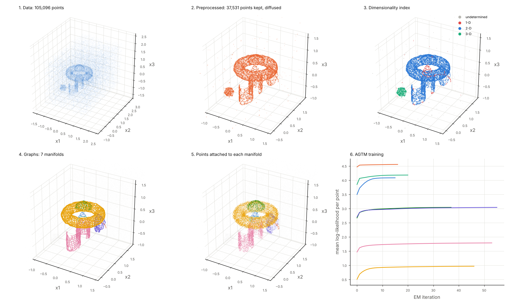
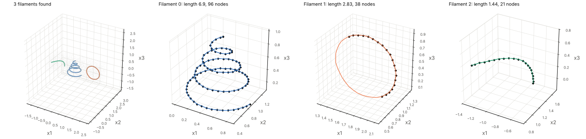
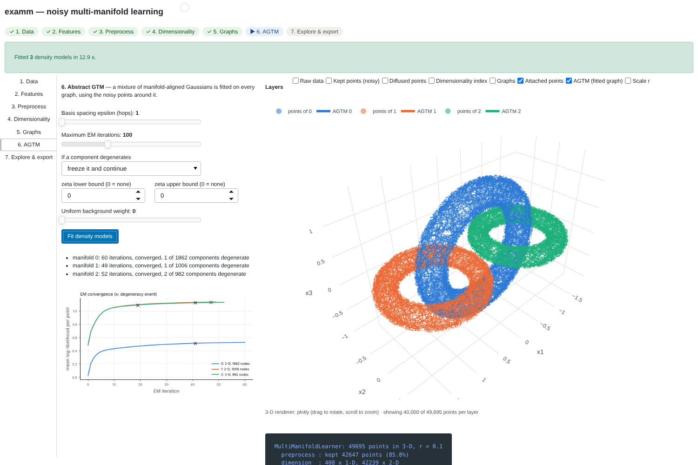

# examm

Python package (C++ core) for **detecting and modelling noisy manifolds of different
dimensions in a point cloud**, after

> M. Canducci, P. Tiňo, M. Mastropietro, *Probabilistic modelling of general noisy
> multi-manifold data sets*, Artificial Intelligence 302 (2022) 103579.

It works for any ambient dimension `d` and any intrinsic dimension `j <= d`. The MATLAB code in
the parent folder is the original implementation; this package is a redesign of it, not a
line-by-line translation (see [Differences from the paper and the MATLAB code](#differences-from-the-paper-and-the-matlab-code)).



## Install

```bash
pip install ./python            # from the repository root; add [viz], [gui] or [all] for the extras
```

Building from source needs a C++17 compiler and CMake (on Ubuntu / WSL: `sudo apt install
build-essential cmake`). Prebuilt manylinux wheels are produced by the `wheels` GitHub workflow
and attached to releases; with a wheel no compiler is needed.

Core dependencies are NumPy and SciPy only. Extras: `examm[viz]` (matplotlib figures),
`examm[gui]` (browser GUI), `examm[io]` (HDF5 and FITS tables).

## Quick start

```python
import examm

learner = examm.MultiManifoldLearner(r=0.1, random_state=0).fit(X)   # X: (n_points, n_features)
print(learner.summary())

learner.dim_index_        # dimensionality index of every point (0 = removed as noise / undetermined)
learner.manifolds_        # list of manifolds: .dim, .graph, .agtm, .point_indices
learner.labels_           # manifold each point is attached to (-1 = none)
learner.score_samples(X)  # log density under the combined model
learner.predict(X)        # most probable manifold
```

`r`, the **characteristic scale**, is the only required parameter: the radius of the local
neighbourhoods. It must be larger than the thickness of the noise around the structures and
smaller than the distance between separate structures.

Every intermediate result is kept, and changing a parameter recomputes only what depends on it:

```python
learner.refit(beta=0.3)        # graphs and density models are recomputed, preprocessing is reused
learner.set_params(epsilon=2)  # marks only the AGTM stage stale
learner.run()
```

## The stages

Each stage can also be used on its own.

| Stage | Function / class | What it does |
|---|---|---|
| Preprocess | `examm.SAF`, `examm.DensityFilter`, `examm.DensityThin`, `examm.Pipeline` | Diffuses points towards the cores of the structures and removes points in sparse regions. `DensityThin` optionally thins over-dense regions first, for data whose density spans orders of magnitude. Returns row-aligned *noisy* and *diffused* point sets. |
| Dimensionality index | `examm.dimensionality_index` | Local PCA; the normalised spectrum is compared with the ideal spectra on the probability simplex (Fisher metric), then smoothed spatially. |
| Graphs | `examm.multi_manifold_crawl`, `examm.crawl`, `examm.epsilon_graph` | Manifold crawling builds a graph skeleton of every manifold of a given dimension; the epsilon-graph is the faster, less stable alternative of the paper's section 4.3. |
| Density model | `examm.AGTM`, `examm.MultiManifoldModel` | Abstract GTM: manifold-aligned Gaussian mixture on each graph, trained by EM; all models combine into one hierarchical mixture. Also gives curvature along graph edges and node-wise means of any per-point quantity. |

```python
pre    = examm.Pipeline([examm.SAF(), examm.DensityFilter()]).fit_transform(X, r)
dim    = examm.dimensionality_index(pre.diffused, r)
sel    = dim.index == 2
graphs = examm.multi_manifold_crawl(pre.diffused[sel], r, dim=2, noisy=pre.noisy[sel], random_state=0)
model  = examm.AGTM(graphs[0]).fit(pre.noisy[sel][graphs[0].points])
model.edge_curvature(); model.score_samples(X); model.node_means(X, some_quantity)
```

### Plugging in another preprocessing step

Denoisers such as LAAT or MBMS (or your own) fit in by implementing one method:

```python
from examm.preprocess import Preprocessor

class MyDenoiser(Preprocessor):
    def apply(self, state, r):
        keep  = ...                       # boolean mask over state.noisy
        moved = ...                       # new positions of the kept points, same shape
        return state.select(keep).with_diffused(moved)

examm.MultiManifoldLearner(r=0.1, preprocess=[MyDenoiser(), examm.DensityFilter()]).fit(X)
```

Steps can be registered by name with `examm.preprocess.register` or through the
`examm.preprocessors` entry-point group of an installed package.

### Main parameters

| Parameter | Default | Meaning |
|---|---|---|
| `r` | – | Characteristic scale (see above). |
| `SAF(radius_factor, mu, n_iter)` | 0.3, 0.3, 10 | Diffusion kernel scale `h = radius_factor * r`, repulsion weight, iterations. `h` should be close to the noise thickness. |
| `DensityFilter(radius_factor, min_points)` | 0.5, 6 | A point is kept if its ball of radius `radius_factor * r` holds at least `min_points` points in both the noisy and the diffused set. `min_points` must separate background from structure; `examm.viz.plot_density_counts` shows the histogram to choose it from. |
| `smooth_factor` | 1.0 | Spatial smoothing radius of the dimensionality index, in units of `r`. |
| `eta`, `beta` | 0.75, 0.4 | Crawling step size and merge tolerance, in units of `r`. |
| `min_nodes` | `4 j + 4` | Smaller graphs are discarded. |
| `epsilon` | 1 | Spacing, in hops, of the AGTM basis-function centres. |
| `agtm_params` | – | Passed to `AGTM`: `max_iter`, `tol`, `zeta_bounds`, `on_degenerate`, ... |

### Hierarchical model and outliers

`examm.HierarchicalAGTM` organises AGTMs in a tree and trains it top-down with the EM scheme of
Tiňo and Nabney's Hierarchical GTM (IEEE TPAMI 24(5), 2002): the children of a trained model are
fitted on all points, each weighted by the parent's responsibility for it, siblings compete for
points, and every model carries a parent-conditional mixing coefficient. Two optional additions
to the paper: each internal node keeps its own model as a *residual* leaf (points of a structure
that none of its sub-structures explains), and a uniform *background* leaf sits under the root.

```python
H = examm.build_hierarchy(X, radii=[0.8, 0.4], background=0.01)   # coarse to fine
print(H.summary())
H.score_samples(X)                 # log density (mixture of the leaves)
H.outliers(X, alpha=1e-3)          # below the 0.1 % quantile of what the structures themselves generate
H.outliers(X, alpha=None, percentile=1)   # or: the lowest 1 % of the data
H.background_probability(X); H.residual_probability(X); H.predict(X)
```

**Regional outliers.** The density score above is low wherever the data are sparse. To ask
instead which points lie farthest *off* a structure at a given position on it, use

```python
res = H.regional_deviation(X)      # dict of arrays, one entry per point
res["leaf_name"], res["node"]      # the structure and the position on it (node; plus toward / fraction)
res["distance"]                    # offset in the space orthogonal to the local tangent
res["p_value"]                     # model tail probability of an offset at least this large
res["regional_rank"]               # rank among the points at the same position (within `hops` graph steps)
H.regional_outliers(X, rank=0.99, p_value=1e-3)
```

Every point is assigned to its most probable structure in the global model, placed at the
nearest position on that structure's graph, and its offset is measured across the manifold
only. `AGTM.orthogonal_deviation` does the same for a single model.

`build_hierarchy` detects structures at the first radius on all data, then searches with each
finer radius inside the region of every current leaf. A tree can also be assembled by hand with
`HierarchicalAGTM().set_data(X)` and `add_children(graphs, parent)`. `AGTM.fit` accepts
`sample_weight`.

### Degenerate mixture components

The covariance scale `zeta_i` of each AGTM component is unbounded by default. Every EM iteration
checks each component for too few points (`min_resp`), a collapsing scale (`collapse_ratio`), an
exploding scale (`explode_ratio`) and non-finite values, and the whole model for a decreasing
log-likelihood. `on_degenerate="freeze"` (default) keeps the offending component's scale fixed
and continues, `"stop"` ends training, `"raise"` raises `DegenerateModelError`. Flags, reasons and
the iteration of each event are in `model.diagnostics_`. `zeta_bounds=(lo, hi)` adds a hard clamp.

## Visualisation

`examm.viz` (matplotlib) has one figure per stage, each returning a `Figure`:

`plot_data`, `plot_preprocess`, `plot_density_counts`, `plot_dim_index`, `plot_simplex`,
`plot_confusion`, `plot_graphs`, `plot_crawl_progress`, `plot_unfolded`, `plot_agtm`,
`plot_loglik`, `plot_curvature`, `plot_node_values`, `plot_summary`, and for one-dimensional
manifolds `plot_filaments`, `plot_profile`, `plot_cross_sections` and `filament_table`.

Data with more than three features are shown with `axes=(i, j, k)` (feature indices) or
`projection="pca"`; computations always use all features.



### Interactive viewer

```python
from examm.viewer import export_viewer
export_viewer("viewer.html", X, {"run A": H_a, "run B": H_b}, names=feature_names,
              extra={"redshift": z, "class": labels})          # extra is optional
```

writes one self-contained HTML page for one or several fitted hierarchies (no server; plotly.js
is embedded). To make a viewer for new data, fit the hierarchies on it and call `export_viewer`
again; `examples/05_viewer_for_your_data.py` does both from the command line.

- **3-D view**: the points with a choice of the three features, the graphs, a tree for switching
  structures, parents, leaves or residuals on and off, and toggles per dimension.
- **Graph view**: one structure at a time, drawn in its own dimension by unfolding its graph
  (multidimensional scaling of the distances along the edges): a curve as a line with a
  profile above it, a surface in the plane, a 3-D structure in space, a 4-D one through 3-D
  projections of four intrinsic coordinates. Nodes can be coloured by points per node, a score,
  outliers per node, degree, curvature, noise scale, covariance scale, degenerate components or
  the mean of any feature or label; edges by curvature, length or the distortion of the layout;
  node size can follow the number of points.
- **Model density**: iso-surfaces (iso-curves when z is set to "none") of the fitted model
  projected onto the shown features, for the ticked structures together or separately. Each
  surface encloses a chosen share (50, 90, 99, 99.9 %) of the model's probability mass, so
  outliers can be checked against the model they are judged by.
- **Outliers**: on any per-point score (log density, orthogonal distance, its Mahalanobis form
  and tail probability, regional rank, background probability), by percentile or by an explicit
  threshold, over all shown points or within each structure. Selections download as CSV.
- **Extra labels**: per-point values (numbers or categories) for colouring points and nodes,
  passed as `extra=` or loaded later in the page from a CSV (one line per point in the original
  order, or with a `row` column holding the point index). A loaded file stays in the browser.

## GUI

```bash
pip install "./python[gui]"
examm-gui                 # or: examm-gui mydata.csv
```

The GUI opens in the browser and walks through the methodology: **Data → Features → Preprocess →
Dimensionality → Graphs → AGTM → Explore & export**. Each step has its parameters, a run button,
key numbers and a diagnostic figure; the 3-D view shows the layers of all completed steps
together (raw data, kept and diffused points, dimensionality index, graphs, attached points,
fitted models, the scale `r`). Changing a parameter marks the later steps as to be redone. The
last step exports the fitted model, per-point results, a summary figure and a Python script that
reproduces the session.

Because it runs in the browser it needs no X server under WSL, and it can be used on a remote
machine through an SSH port forward (`ssh -L 5006:localhost:5006 host`, then `examm-gui
--no-browser` on the host).

The 3-D view is drawn by Plotly (WebGL in the browser). `examm-gui --backend pyvista` renders the
view with PyVista on the server instead and shows the image with camera sliders; this needs an
off-screen OpenGL library (`sudo apt install libosmesa6`).



## Examples

- `examples/walkthrough.ipynb` – the whole methodology step by step, with figures.
- `examples/01_three_toroids.py`, `02_mixed_manifolds_D1.py`, `03_torus3_in_4d.py`,
  `04_filaments_1d.py`.
- `benchmarks/bench.py` – time per stage. On 4 cores: about 20 s for the 105 000-point data set D1
  and 25 s for 315 000 points, most of it in the AGTM fit.

`examm.datasets` generates the paper's data sets (`make_d1`, `make_three_toroids`, `torus3`, ...).

## Differences from the paper and the MATLAB code

The package follows the paper's methodology; where the paper and the MATLAB code disagree, or
where a different choice is numerically sounder, it deviates. All of these are parameters.

| Topic | Paper | MATLAB | examm |
|---|---|---|---|
| Ambient / intrinsic dimension | any | 3-D, `j <= 2` (`j <= 3` in an unused variant) | any `d`, any `j <= d` |
| SAF | `h = 0.05`, `mu = 1e-3`, 5 iterations | same scheme, hard-wired to 3-D | same scheme; defaults `h = 0.3 r`, `mu = 0.3`, 10 iterations. With almost no repulsion, surfaces and volumes clump into ridges and are then labelled 1-D; these defaults reproduce the paper's index accuracy on D1. |
| Density filter | both balls sparser than `tau` → removed | count > 5, result depends on the order of the points | order-independent: keep points with `>= min_points` neighbours in both sets (`mode="core+border"` also keeps their neighbours); radius `r / 2` |
| Barycentric coordinates | solved per point | 3-D triangulation | closed form `alpha_j = j (lambda_j − lambda_{j+1})` for any `d` |
| Index smoothing radius | `r` | `2 r` | `smooth_factor * r`, default `r` |
| Too-small neighbourhoods | – | NaN rows silently dropped (misaligning the output) | index 0, output always aligned with the input |
| Tangent frame while crawling | parent eigenvectors projected and normalised | two (or three) stored edge directions | parent frame projected and re-orthonormalised (polar factor), any `j` |
| Node degree | not limited | at most `2 j`, with exceptions | at most `2 j` (one neighbour per ± frame direction) |
| Node identity | – | coordinates printed to strings and parsed back | point indices |
| Minimum graph size | – | `2 j + 2` nodes | `4 j + 4` nodes (`min_nodes`) |
| Basis functions | RBF of graph distance, `gamma = 2 epsilon` | width `3 x` centre spacing, centres only at nodes of degree `> j` | RBF of graph distance, `gamma = 2 epsilon`, **normalised** to sum to one at every node, centres from an epsilon-net over all nodes. Plain RBFs cannot reproduce the node positions of an irregular crawled graph (residual larger than the node spacing); normalised ones can. |
| Local covariance | kernel scale `l_i` (mean embedded edge length) | kernel scale `2 r`, replaced by `0.01 I` if ill-conditioned | paper's `l_i`, relative eigenvalue floor (`cov_floor`) |
| W update | eq. 9 | truncated-SVD pseudo-inverse; precisions rescaled cumulatively across iterations | eq. 9 with consistent precisions, Cholesky or conjugate gradients |
| zeta | eq. 10, unbounded | clamped to [0.1, 2] | eq. 10, unbounded, with degeneracy detection; optional bounds |
| Log-likelihood | – | not guaranteed to increase | monotone (checked every iteration) |
| Curvature | eq. 23 (second difference) | – | eq. 22 (change of unit tangent per arc length, default) or eq. 23 |
| Combined model | hierarchical mixture | manifold weights not normalised by component count | weights proportional to points per manifold; optional uniform background |

Things that are **not** included: the LAAT and MBMS preprocessing of 1-DREAM (the interface for
adding them is there), and iso-surface rendering of the density.

## Tests

```bash
pip install "./python[test]"
pytest python/tests
```

The suite checks the compiled kernels against brute-force NumPy references, the index on flats of
every dimension, crawling on circles, a torus, a Möbius strip and a 3-torus in 4-D, AGTM
(monotone likelihood, normalised density, curvature of circles equal to the inverse radius,
degeneracy handling) and the full pipeline on the paper's data sets.

## Licence

GNU Affero General Public License v3 or later, as the MATLAB sources.
